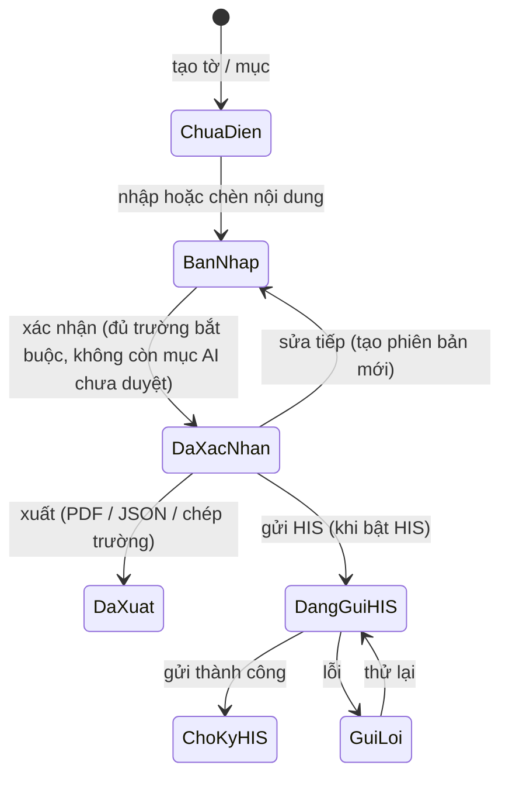

# Prototype Module 3 — Hỗ trợ lập bệnh án (chạy độc lập)

## Mục tiêu

Dựng prototype tương tác cho toàn bộ Module 3 theo master plan v0.5 (`output/MedVita_Module_3_Ke_hoach_phat_trien.xlsx`). Prototype phải cho người xem thấy:

- Module 3 chạy trọn luồng khi không có HIS, Module 1, Module 2.
- HIS / EMR, Module 1, Module 2 là phần cắm thêm: bật lên thì có thêm dữ liệu và đích đồng bộ, tắt đi thì luồng chính không đổi.
- MedVita là nơi làm việc; hồ sơ chính thức và chữ ký ở HIS / EMR (D-02 hướng 1).
- AI chỉ tạo bản nháp có nguồn; người có thẩm quyền xem và xác nhận trước khi xuất.

Prototype là bằng chứng về tương tác mong muốn, không phải requirement chính thức và không chứng minh production đã có.

## Quyết định đã chốt

| Chủ đề | Lựa chọn |
| --- | --- |
| Phạm vi | Toàn bộ Module 3, các màn đều tương tác đầy đủ |
| Thiết bị | Web desktop; thêm màn mobile cho đi buồng |
| Dữ liệu demo | Khoa Phục hồi chức năng (PHCN) và khoa Nội; bệnh viện đặt tên chung |
| Giao diện | Giữ tông teal và font Be Vietnam Pro của `module3.html` cũ |
| AI | Kịch bản giả lập, không gọi model hay micro thật |
| Code | Thư mục `module3/` nhiều file, script thường (chạy được bằng `file://`), một lệnh gộp ra `module3-v2.html` |

## Màn hình và tính năng

ID tính năng theo sheet *Danh sách tính năng*; hạng mục theo sheet *Kế hoạch & Gantt*.

| Màn | Nội dung chính | Feature | Hạng mục |
| --- | --- | --- | --- |
| Đăng nhập | Tài khoản MedVita, chọn khoa; thanh trạng thái "Chạy độc lập · HIS chưa kết nối" | F3-004, F3-005 | 1.4 |
| Bảng quản lý điều trị | Bệnh nhân theo khoa: giường, chẩn đoán, ngày điều trị thứ N, trạng thái tờ hôm nay, % đủ trường bệnh án, người phụ trách, lọc, số tổng đầu trang | F3-061 → F3-065, F3-067 | 2.2 |
| Tạo bệnh nhân / đợt điều trị | Nhập tay hành chính, tiền sử, CLS; tải PDF / ảnh / scan, AI trích ra trường (giả lập); "Lấy từ HIS" khi bật HIS | F3-006, F3-086, F3-009 | 1.5, 4.3 |
| Hồ sơ đợt điều trị · Tờ điều trị | Danh sách ngày; tờ hôm nay kế thừa tờ hôm trước, tô sáng thay đổi; Diễn biến / Y lệnh / Chăm sóc; trợ lý AI; xác nhận; xuất | F3-028, F3-029, F3-035 → F3-045, F3-073, F3-074, F3-075, F3-087, F3-088 | 1.1, 1.2, 1.6, 2.4, 5.6 |
| Hồ sơ đợt điều trị · Bệnh án | Chọn mẫu (PHCN, Nội khoa); AI soạn nháp từng mục có nguồn; kiểm tra chất lượng; xác nhận từng phần và xác nhận cuối | F3-010, F3-013, F3-014, F3-019, F3-049 → F3-054, F3-084 | 5.1 → 5.4 |
| Hồ sơ đợt điều trị · Nguồn dữ liệu | Mọi nguồn (nhập tay, tài liệu, ghi âm, Module 1 / 2 / HIS khi bật) với người nhập, thời điểm; nguồn từng trường | F3-007, F3-008, F3-011, F3-012, F3-018 | 4.1, 4.2, 4.4 |
| Hồ sơ đợt điều trị · Ra viện | Tờ điều trị tổng hợp, tổng kết bệnh án, giấy ra viện; AI soạn nháp, xác nhận, xuất | F3-032, F3-033, F3-034 | 6.1 |
| Hồ sơ đợt điều trị · Lịch sử | Phiên bản, ai sửa gì, khóa sau xác nhận, audit | F3-070, F3-071 | 1.9, 2.1 |
| Xuất dữ liệu | Chép từng trường, bản in PDF, file JSON; khi bật HIS: gửi HIS / EMR, trạng thái, thử lại, "Chờ ký trên HIS" | F3-055 → F3-060 | 1.6, 6.2, 6.3 |
| Cấu hình mẫu (quản trị) | Danh mục mẫu, trường, trường bắt buộc, kiểu dữ liệu, phiên bản mẫu | F3-021 → F3-027 | 3.1 → 3.3 |
| Tích hợp (quản trị) | Bật / tắt HIS, Module 1, Module 2; trạng thái kết nối | F3-001 → F3-003, F3-056, F3-060 | 4.x, 6.2 |
| Phiếu chăm sóc điều dưỡng | Lời nói → sinh hiệu có cấu trúc chờ điều dưỡng xác nhận; bàn giao ca SBAR | F3-077 | 7.1 |
| Báo cáo | Thời gian làm hồ sơ, mức chỉnh sửa, tỷ lệ đủ trường, theo khoa / bác sĩ | F3-065, F3-066, F3-079 | 1.8, 7.3 |
| Mobile đi buồng | Danh sách buồng → bệnh nhân → ghi âm / đọc chính tả nhiều lần, gộp vào tờ trong ngày; hàng chờ khi mất mạng | F3-076 | 5.7 |
| Bảng điều khiển demo | Bật / tắt "Có HIS", "Có Module 1–2", "AI gián đoạn"; đổi vai trò; reset dữ liệu | — | — |

Không làm: chẩn đoán / gợi ý điều trị (F3-085, Won't); ký điện tử trong MedVita (F3-080, chỉ khi đổi D-02).

## Vai trò và dữ liệu demo

- **Bệnh viện:** "Bệnh viện Đa khoa Demo". Hai khoa: Phục hồi chức năng, Nội tổng hợp.
- **Tài khoản** (mật khẩu `123456`), mỗi tài khoản một vai trò:

  | Tài khoản | Vai trò |
  | --- | --- |
  | `bs.phcn` | Bác sĩ điều trị PHCN |
  | `bs.noi` | Bác sĩ điều trị Nội |
  | `dd.phcn` | Điều dưỡng PHCN |
  | `tk.phcn` | Trưởng khoa PHCN |
  | `admin` | Quản trị |

- **Bệnh nhân:** 8 người (5 PHCN, 3 Nội), ở nhiều trạng thái: chưa có tờ hôm nay, bản nháp, đã xác nhận, đã xuất, sắp ra viện.
- **Dữ liệu mỗi bệnh nhân:** mỗi người có 2–6 ngày tờ điều trị trước đó, nguồn dữ liệu (nhập tay, tài liệu tải lên, ghi âm) và bệnh án theo mẫu ở các mức hoàn thành khác nhau.
- **Mẫu bệnh án:** 2 mẫu (PHCN, Nội khoa), mỗi mẫu có mục, trường, trường bắt buộc, kiểu dữ liệu.
- **Danh mục thuốc demo:** dùng để kiểm Y lệnh. Mỗi thuốc có hàm lượng, đơn vị hợp lệ, liều tối đa mỗi lần và mỗi ngày.
- **Ngày "hôm nay"** của demo là 11/10/2026. Dữ liệu là dữ liệu demo, không phải dữ liệu thật.

## Hành vi AI giả lập và an toàn

- **Nhãn và ghi đè:**
  - Nội dung AI mang nhãn "Bản nháp AI", viền vàng, chỉ vào ô khi người dùng bấm *Chèn*.
  - AI không ghi đè: ô đã có nội dung thì hỏi *Chèn thêm* hay *Thay thế*.
  - Mục do AI điền phải được người dùng xác nhận (✓) trước khi xác nhận cả tờ / mục.
- **Nguồn:**
  - Mỗi gợi ý kèm danh sách nguồn.
  - Bôi đen một câu trong bản nháp → popover hiện đoạn nguồn sinh ra câu đó; câu không có nguồn được gắn cờ.
- **Kiểm soát Y lệnh** (`domain.checkOrder`):
  - Đối chiếu từng dòng với danh mục thuốc demo; phát hiện liều mỗi lần / mỗi ngày vượt mức, đơn vị không hợp lệ, thuốc không có trong danh mục.
  - Có cảnh báo thì hiện hộp hỏi lại; bác sĩ phải sửa hoặc ghi lý do mới chèn được.
- **Từ chối an toàn:**
  - Yêu cầu ngoài phạm vi (chẩn đoán, gợi ý điều trị, kê đơn mới) → AI từ chối, nói rõ lý do.
  - Thiếu dữ liệu để trả lời → AI nói thiếu gì và gợi ý nhập tay hoặc tải tài liệu.
- **AI gián đoạn** (bật ở bảng demo):
  - Mọi nút AI chuyển trạng thái tắt.
  - Banner báo "AI tạm gián đoạn — vẫn nhập, lưu, xác nhận, xuất bình thường", kèm nút *Thử lại*.
- **Đọc chính tả / ghi âm:** giả lập bằng cách hiện dần câu mẫu theo ngữ cảnh ô đang chọn; có tạm dừng / tiếp tục / dừng.

## Vòng đời hồ sơ



- *Đã xác nhận* khóa nội dung; sửa tiếp tạo phiên bản mới, giữ phiên bản cũ ở tab Lịch sử.
- *Xác nhận* bị chặn khi thiếu trường bắt buộc hoặc còn mục AI chưa duyệt; hộp thoại liệt kê mục còn thiếu và nhảy tới mục đó.
- Gửi HIS có giả lập lỗi để thấy trạng thái *Gửi lỗi* và *Thử lại*; dữ liệu không mất.
- Mọi thao tác chính ghi audit (người, thao tác, thời điểm, đối tượng).

## Kiến trúc code

```text
module3/
├── index.html            # khung trang, nạp CSS và script theo thứ tự
├── build.mjs             # gộp CSS + JS → ../module3-v2.html (node, không thư viện)
├── css/
│   ├── tokens.css        # màu, font, khoảng cách
│   ├── app.css           # layout và thành phần desktop
│   └── mobile.css        # màn đi buồng
└── js/
    ├── core/
    │   ├── store.js      # state, localStorage (try/catch), subscribe, reset
    │   ├── router.js     # hash route → screen
    │   ├── ui.js         # dựng DOM, modal (focus trap, Esc), toast aria-live
    │   ├── domain.js     # logic thuần: vòng đời, trường bắt buộc, Y lệnh, kế thừa, phiên bản
    │   └── ai-sim.js     # kịch bản AI: gợi ý, nguồn, từ chối, gián đoạn, đọc chính tả
    ├── data/
    │   └── demo.js       # bệnh viện, khoa, tài khoản, bệnh nhân, tờ, nguồn, mẫu, danh mục thuốc
    └── screens/          # mỗi màn một file, đăng ký vào window.M3.screens
        ├── login.js  board.js  intake.js  episode.js  sheet.js  record.js
        ├── sources.js  discharge.js  history.js  export.js  templates.js
        └── integrations.js  nursing.js  reports.js  mobile.js  demo-panel.js
```

- Script thường (không ES module) để mở trực tiếp bằng `file://`. Mọi file gắn vào namespace `window.M3`.
- `domain.js` không đụng DOM, không đọc `window` ngoài `M3`, để test chạy được bằng node.
- **Route:**

  | Route | Màn |
  | --- | --- |
  | `#/login` | Đăng nhập |
  | `#/board` | Bảng quản lý điều trị |
  | `#/intake` | Tạo bệnh nhân / đợt điều trị |
  | `#/episode/:id/:tab[/:date]` | Hồ sơ đợt điều trị (tab: `sheet`, `record`, `sources`, `discharge`, `history`) |
  | `#/admin/templates` | Cấu hình mẫu |
  | `#/admin/integrations` | Tích hợp |
  | `#/nursing` | Phiếu chăm sóc điều dưỡng |
  | `#/reports` | Báo cáo |
  | `#/m/ward`, `#/m/patient/:id` | Mobile đi buồng |

- **Render:** mỗi màn có `render(params)` trả về DOM. Store đổi thì vẽ lại màn hiện tại. Ô đang soạn ghi thẳng vào store khi gõ và không kích hoạt vẽ lại, để giữ con trỏ.
- **Lưu trữ:** state lưu localStorage khóa `m3-proto-v1`. Đọc / ghi bọc try/catch; không lưu được thì vẫn chạy bằng dữ liệu demo trong bộ nhớ.
- **Font:** Be Vietnam Pro qua Google Fonts; offline dùng font hệ thống.

## Phân phối

- `node module3/build.mjs` tạo `module3-v2.html` ở gốc repo: một file, inline toàn bộ CSS và JS, dùng để gửi email.
- `index.html`:
  - thêm thẻ "Module 3 — Hỗ trợ lập bệnh án (chạy độc lập)" trỏ tới `module3/index.html`;
  - thẻ cũ đổi tên thành "Module 3 — bản cũ (mở từ HIS)".
- `module3.html` cũ giữ nguyên.

## Accessibility và responsive

- Modal có `role="dialog"`, `aria-modal`, focus trap, đóng bằng Esc, trả focus về nút mở.
- Toast có `role="status"` và `aria-live="polite"`; nút chỉ có icon có `aria-label`.
- Ô soạn thảo có `role="textbox"` và `aria-label`.
- Hỗ trợ `prefers-reduced-motion`.
- Desktop tối ưu từ 1280px, vẫn dùng được ở 1024px. Màn mobile thiết kế cho 360–430px; mở `#/m/...` trên desktop thì hiển thị trong khung điện thoại.

## Kiểm thử

- `tests/module3-domain.test.js`, chạy `domain.js` trong `node:vm`:
  - chuyển trạng thái hợp lệ / không hợp lệ;
  - chặn xác nhận khi thiếu trường bắt buộc hoặc còn mục AI chưa duyệt;
  - phát hiện liều / đơn vị bất thường;
  - tính phần thay đổi so với tờ hôm trước;
  - tạo phiên bản khi sửa nội dung đã xác nhận.
- `tests/module3-prototype.test.js`:
  - mọi route trỏ tới màn đã đăng ký;
  - dialog có đủ thuộc tính accessibility;
  - `index.html` có thẻ mới;
  - file gộp chứa đủ script và CSS.
- Chạy: `node tests/module3-domain.test.js && node tests/module3-prototype.test.js`.
- Soát giao diện bằng ảnh chụp headless các màn chính (Chrome headless nếu có trên máy).

## Thứ tự build

1. Khung: tokens, store, router, ui, dữ liệu demo, đăng nhập, bảng quản lý, bảng điều khiển demo.
2. Tờ điều trị: kế thừa tờ hôm trước, trợ lý AI, kiểm soát Y lệnh, từ chối an toàn, chế độ nhập tay, xác nhận, xuất.
3. Tạo bệnh nhân / nhập nguồn, tab Nguồn dữ liệu, tab Lịch sử.
4. Bệnh án theo mẫu, kiểm tra chất lượng, xác nhận nhiều cấp, cấu hình mẫu.
5. Ra viện, tích hợp, điều dưỡng, báo cáo.
6. Mobile đi buồng, `build.mjs`, cập nhật `index.html`, test.

Xong mỗi bước thì mở được và xem được phần đã làm.

## Giả định

- Cấu trúc tờ điều trị dùng 3 ô Diễn biến / Y lệnh / Chăm sóc như bản cũ. D-20 (theo mẫu MS 36/BV2) chưa chốt nên ghi chú trên màn.
- Mức mục tiêu KPI ở màn Báo cáo là số demo, gắn nhãn "dữ liệu demo".
- Nội dung lâm sàng demo do người lập soạn để minh họa, cần bác sĩ chuyên môn rà trước khi đưa cho bệnh viện xem.
